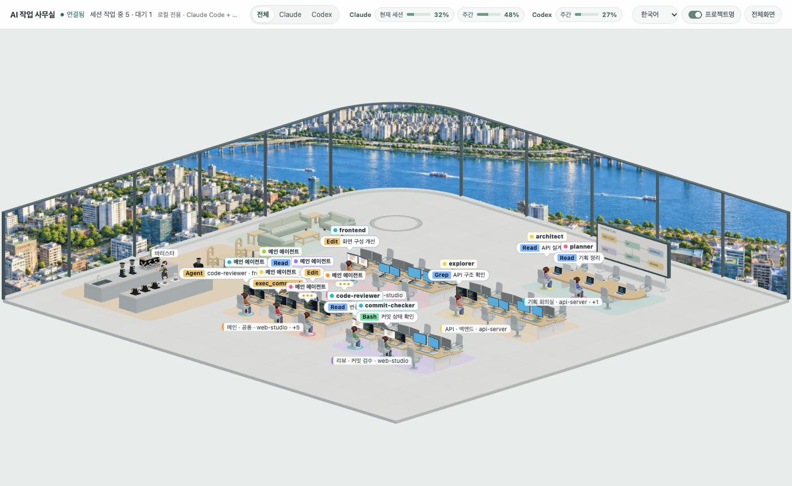
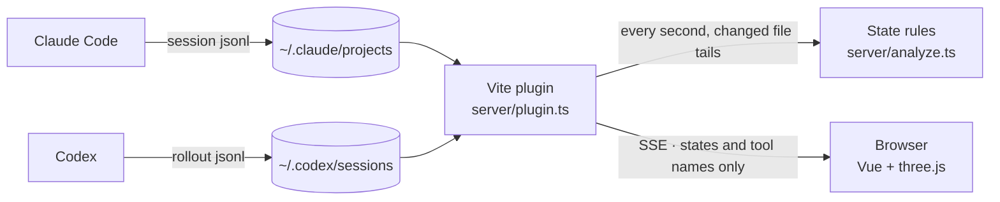

<div align="center">

[한국어](README.md) · **English** · [日本語](README.ja.md) · [中文](README.zh.md)

# Agent Office

**A local dashboard that shows what your Claude Code and Codex sessions are doing, as characters in a 3D office**

The main agent types at its desk, delegated subagents work at the desks next to it, and when it needs your answer, a speech bubble pops up right at its seat.




<p><sub>Shown with synthetic test data: six sessions and six subagents. No real conversations or project information are included.</sub></p>

</div>

---

## Why

When you run several Claude Code or Codex sessions, the terminal alone makes it hard to see who is doing what, and which session is waiting for you. Agent Office reads their local session logs and shows **one workspace per role** and **one character per agent**. There is nothing to install or configure. Just keep it open.

## Features

- **Role workspaces** — The 18×18 office has five areas: planning, API/backend, design, review/commit checks, and main/shared. Each has six seats, for 30 total; up to six sessions are visible.
- Seats face one another in each area. Planning has a rounded meeting table, laptops and a diagram board; design has drawing tablets and pens. Review and commit agents share an open six-computer workspace. The diagram board is decorative.
- Planning occupies the former API area by the right-hand windows; API/backend moves into the previously empty middle-right area. The former planning area remains open.
- Roles use existing agentType first, then short description metadata. No additional transcript bodies or tool inputs are collected. The current Codex collector supplies no role metadata, so Codex subagents use the shared area. Other unknown roles use the shared area with priority seating for mains. Full role areas use nearby standing spots. Tool changes do not move agents; late role metadata can move an unknown agent once.
- **Characters that show their state** — They sit and type while working, switch to a reading pose while reading files, bounce a speech bubble while waiting for you, and idle subagents wander around the office.
- **Tool chips in speech bubbles** — The tool in use (`Bash`, `Read`, `Edit` …) and the description of the delegated task. MCP tools are shortened for readability, e.g. `playwright · take screenshot`.
- **Subagent tracking** — Follows background agents too, and the main bubble says who it is waiting for (`Waiting for code-reviewer ×2`).
- **Detail card** — Click a character or name tag to see its state, tool, last activity and delegated agents.
- **Stall detection** — A subagent that has waited too long for a tool result gets a red `Not responding` chip.
- **Usage gauges** — The top bar shows Claude and Codex quota usage separately as percentages and bars. Hover for reset times; missing data displays `—`.
- **Service filter** — Choose `All | Claude | Codex` in the top bar to filter sessions and their subagents. All is the default; the selection is saved in the browser. Counts and detail cards follow the selection. Usage stays separate by service; Codex usage comes from the latest local token_count.rate_limits record, never summed across sessions. Labels follow window_minutes, including weekly-only plans. Hover for recorded/reset times. Missing or expired windows show `—`; fresh rollout events are needed to update usage. No credentials or token-based estimates are used. The cached reader checks files modified within eight days and reads up to the last 2MB per file initially.
- For both Claude and Codex, an expired usage window shows `—` until a fresh record arrives. Waiting agents can take a seat when one opens in their role area.
- **Screen-sharing switch** — Hide project names.
- **4 languages** — 한국어 · English · 日本語 · 中文. Follows your browser language and can be changed from the HUD.
- **Never sends message content** — Only states and tool names reach the browser. Conversation text and tool input/output never leave the server.

## Quick start

### Requirements

- [Node.js](https://nodejs.org) 22.12 or later (22 LTS, or 24+)
- A machine where you use [Claude Code](https://docs.claude.com/en/docs/claude-code) or [Codex](https://openai.com/codex/) (session logs are read from the same machine)

### Install and run

```bash
git clone <this-repo-url> agent-office
cd agent-office
npm install
npm run dev
```

Open <http://localhost:5180> in your browser, then use Claude Code or Codex as usual. Characters will walk into the office.

> [!NOTE]
> Session data is served by a Vite plugin on the dev server. The output of `npm run build` (static files) does not work on its own.

### Troubleshooting

- **`vite: command not found`** — Dependencies are not installed yet. Run `npm ci` in the project folder.
- **`Cannot find module @rollup/rollup-…`** or an esbuild platform error — This happens when `node_modules` was copied from another computer (e.g. Apple Silicon Mac ↔ Intel Mac). Reinstall with `rm -rf node_modules && npm ci`. When moving the project, copy it without `node_modules` and `dist`.

`npm run dev` checks for both cases before starting (`scripts/check-deps.mjs`) and tells you what to do.

## Reading the screen

| What the character does | Meaning |
|------|------|
| Sits and types, the right monitor's terminal scrolls | Running a tool or composing an answer (the terminal scrolls faster for `Bash`) |
| Sits in a reading pose, the terminal scrolls slowly | Running a read tool such as `Read`, `Grep` or `Glob` |
| A `•••` bubble bounces with the name tag | Waiting for you (`AskUserQuestion`, or finished answering and it is your turn) |
| Leaves its desk to wander around or take a seat at the tea table | A subagent has had no activity for over 2 minutes (idle) |
| Sits on the lounge sofa/chair or drinks coffee | Only with `MAIN_STAYS_SEATED = false`: the main session has been waiting for you for over 1 minute |
| Red `Not responding` chip | A subagent has not received a tool result for over 12 minutes |
| Walks out the door | The session or agent ended |

- **Name tag dots and foot rings** identify sessions; **floor colors** identify roles. Clothing colors vary across agents in both 2D and 3D.
- The two rear glass walls share an elevated view of the river, bridges and city buildings along both banks. A radius-3 curved glass corner joins the two window walls without a central upright. The broad composition balances river, bridges and city buildings without emphasizing a landmark. Recessed glazing, substantial frames and interior sills define the room edge. Compare straight windows with `?hour=18&window=square`. Day, sunset and night images blend with your clock; sunset also warms the indoor sunlight. Shared projection preserves the image proportions and a continuous horizon across both windows. The texture updates only when images load or the time changes. Use `?hour=18` for sunset or `?hour=22` for night. [Sunset](docs/screenshot-sunset.png) · [Night](docs/screenshot-night.png)
- Desks combine rounded oak tops, white slab supports and sage desk mats, keeping the existing seating clearance and desktop height.
- The lounge moves 2.25 units toward the café, with a clear passage to the tea tables. The sofa and armchairs use sage fabric, rounded arms, low backs, separate cushions and wooden feet, preserving seat heights and spacing.
- The planning room sits closer to the API area, and work areas are grouped slightly to the right. Visible monitor fronts are filled first; each desktop has a slim silver keyboard, silver monitor stands and one Mac mini-style computer. Planning uses laptops, review has six open workstations, and the café has a wider, shallower bar shifted slightly left, separated tables on a wider café rug, more space between equipment, three kettles and a working barista. Stand lamps and potted plants are omitted.
- The default characters are **2D sprites** generated from the approved concepts, with directional views, four walking phases and two typing frames, seated and coffee poses. Set `cap: true` in `AGENT_LOOKS` for a cap. `glasses: true` uses the existing 3D character; set `CHARACTER_RENDER_STYLE` to `'3d'` to restore all 3D models. [2D close-up](docs/screenshot-sprite-closeup.png) · [Cap in the office](docs/screenshot-sprite-cap.png)
- The lounge moves 0.45 units inward from the glazing, leaving more space behind the sofa. The rug, tables, chairs, lights and seated positions move together.
- Meeting tables have MacBook-style laptops. Design/review desks show design screens; backend/server/shared desks show terminals.
- **Mouse wheel** zooms in and out. The top-right button toggles fullscreen.
- **Click a character or name tag** to open the detail card. Click empty space or press `Esc` to close it.
- The **language selector** at the top right changes the UI language. It starts with your browser language (English if unsupported) and is remembered in the browser.
- Turn off the **`Project names` switch** at the top right to hide project names on zone labels and the card. This is remembered too.
- While the browser tab is hidden, the connection and rendering pause, and resume when the tab is visible again.

## How it works



1. Claude Code writes logs under `~/.claude/projects`; Codex writes rollout files under `~/.codex/sessions/YYYY/MM/DD/rollout-*.jsonl`. Set `CODEX_HOME` to use a different Codex data directory. Codex subagents are linked to their parent by `parent_thread_id`.
2. The plugin discovers session files every 5 seconds and checks known recent files and updates their states every second. New sessions and sessions resuming after a long pause can take up to 5 seconds to appear. The dev server plugin picks sessions modified in the last 30 minutes (and sessions that are currently open), reads the end of each file, and decides the state from whether a tool is awaiting its result and whether the answer has finished. Unchanged files are not read again. Codex identity metadata is cached and refreshed when a file is replaced or rewritten.
3. For Claude Code, it also checks per-process session files. For Codex, it uses task start/completion events and the latest log activity.
4. It pushes a snapshot over SSE only when something changes, and the browser draws the office from it. Opening many tabs still means one timer and one read on the server.

<details>
<summary><b>State rules in detail</b></summary>

The rules are pure functions in `server/analyze.ts`, tested by `server/analyze.spec.ts`.

| State | Condition |
|------|------|
| Working | A `tool_use` is still waiting for its result, or an answer is being composed |
| Waiting | The pending tool is `AskUserQuestion`, or the main session has finished answering and it is your turn |
| Idle | No activity for over 120 seconds since the last log entry |
| Not responding | A subagent has not received a tool result for over 12 minutes. Set longer than the maximum Bash timeout (10 minutes); `Agent`, `Task` and `Workflow`, which start further subagents, are excluded |
| Left | See the end conditions below |

- **An answer is finished** only when there is a `text` block and `stop_reason` is `end_turn`, `stop_sequence` or `max_tokens`. Claude Code logs one response as several lines (a thinking line, then a `tool_use` line 1–3 seconds later), so the absence of a tool call alone is not treated as the end.
- **A subagent ends** when `SubagentHandback` gets a successful result, or when it writes a finished-answer line. If work resumes afterwards, it goes back to working.
- **The main session leaves** when the Claude Code process using that session ends (the window was closed, or it moved to another session via `/clear` etc.). While the process is alive it keeps its seat no matter how quiet it is, and a brand-new session gets a 30-second grace period. Where process information is unavailable (older versions etc.), it leaves after 10 minutes of quiet with no pending tool.
- Finished subagents stay visible for 60 more seconds for the exit animation. Subagents of a session whose process has ended leave right away with it.
- **The main session while subagents work** is treated as working (`Agent`) even if its own log looks waiting or idle. Background agents return their `Agent` result immediately, so the main log alone would look like it is your turn.
- **Subagent names** come from `agentType` in `meta.json`. If the jsonl appears before the meta file, the agent is held back for up to 5 seconds until its meta arrives.
- **Project names** are the last segment of the first `cwd` in the session log (the folder the session started in). Later `cwd` values follow shell `cd`, so they are ignored.

</details>

<details>
<summary><b>When there are more sessions than zones</b></summary>

The office has 6 session display slots, independent of role workspaces. When more sessions are alive, the HUD shows a notice and zones are assigned in this order:

1. Empty display slots go to working sessions (main or a subagent is working) first, then by most recent activity.
2. If all display slots are taken and a working session is left out, the characters of the quietest non-working session walk out and hand over their display slot.
3. Working sessions never push each other out (so seats don't keep swapping as activity times change).

</details>

## Configuration

### Fitting it to your project

Sessions and subagents of any project show up **without configuration**. Everything you might want to change lives in one file: [`src/agent-office/office.config.ts`](src/agent-office/office.config.ts).

| Setting | What it does | If left empty |
|------|------|------|
| `CHARACTER_RENDER_STYLE` | Character rendering mode | `'sprite'` for 2D or `'3d'` for the previous 3D models |
| `AGENT_LOOKS` | Character model, cap, glasses and clothing per agent type | 2D supports clothing colors and optional caps; glasses use the 3D model |
| `SEAT_OF_TYPE` | Preferred seat (0–5) per agent type | `SEAT_OTHER` → any free seat |
| `AGENT_NAMES` | Name shown on the name tag | `agentType` as is. Plugin agents (`feature-dev:code-reviewer`) show as `code-reviewer` |
| `OFFICE_ART` | Freestanding picture display (`'seaside'` or `'skyline'` pixel art) | `null` shows the `OFFICE_SIGN` text |
| `OFFICE_SIGN` | Wall frame text | No frame if both are empty |
| `MAIN_STAYS_SEATED` | The main Claude always stays at its desk (default `true`) | `false` makes it go to the lounge while waiting and wander when quiet for long |

```ts
// Example: give your agents names and seats
export const AGENT_NAMES: Record<string, string> = {
  'general-purpose': 'Generalist',
  'feature-dev:code-reviewer': 'Reviewer',
}
export const SEAT_OF_TYPE: Record<string, number> = { 'feature-dev:code-reviewer': 4 }
```

### Live usage updates (optional)

By default the top bar shows the usage Claude Code saves in `~/.claude.json`, which is refreshed only now and then. Claude Code passes the latest usage to the status line command every time it draws the status line, so placing a small bridge in front of your status line makes the top bar update live.

```bash
npm run statusline:install    # install: save your current status line command (claude-hud etc.) and wrap it with the bridge
npm run statusline:uninstall  # uninstall: restore the original status line
```

- The bridge (`scripts/statusline-bridge.mjs`) writes only the usage percentages to `~/.claude/agent-office-usage.json`, then runs your original status line command with the same input and passes its output through unchanged. Your status line looks the same.
- Install backs up `settings.json` to `settings.json.agent-office-backup` and changes only the `statusLine` command.
- If you move the project folder, the bridge path changes, so install again.

### Port

The default port is **5180**, chosen to avoid other Vite projects (default 5173). If it is already in use, the server fails instead of moving to another port (`strictPort`). Change `server.port` in [`vite.config.ts`](vite.config.ts) to use a different one.

### Session log location

Claude Code logs default to `~/.claude/projects` (`%USERPROFILE%\.claude\projects` on Windows). Codex logs default to `~/.codex/sessions` (`%USERPROFILE%\.codex\sessions` on Windows). Set `CLAUDE_CONFIG_DIR` or `CODEX_HOME` in the shell that starts the dev server if you moved either data directory.

```bash
CLAUDE_CONFIG_DIR=/path/to/claude-config npm run dev
```

```bash
CODEX_HOME=/path/to/codex-home npm run dev
```

> [!TIP]
> If you use Claude Code inside **WSL**, run Agent Office inside WSL too. Started from Windows, it reads your Windows user folder instead of the `~/.claude` inside WSL.

## Security and privacy

Session logs contain the raw conversation and tool input/output, which may include sensitive information. So Agent Office:

- Sends only **session ID · project name · agent ID · agent type · description · tool name · timestamps · state · usage percentages and reset times** to the browser.
- Usage is read as numbers only from the value Claude Code stores in `~/.claude.json` (`cachedUsageUtilization`). It never reads credentials or calls an API, so the top bar updates when Claude Code refreshes its usage (with the status line bridge installed, every time the status line is drawn). Message text and tool input/results are never sent.
- Binds to `localhost` only, and answers only when both the remote address and the `Host` header are loopback (otherwise `403`). This also blocks external pages from reading it via DNS rebinding.
- Has no login, so never expose the server to a network.

## Known limitations

- **Session log formats can change.** Claude Code and Codex do not promise these local log formats as stable APIs, so updates may affect state detection. Unknown fields are ignored and broken lines are skipped.
- The display limit is 6 sessions, so with 7 or more sessions open some of them are not shown.
- When the process cannot be checked — for example, viewing Claude Code inside WSL from an Agent Office started on Windows — sessions are treated as open.
- A force-killed subagent takes 12 minutes to show `Not responding` (headroom so that long builds are not misreported).
- The camera looks down at seated characters from behind, so typing is not as clear as it would be from the front.

## Development

| Command | Description |
|------|------|
| `npm run dev` | Dev server (<http://localhost:5180>) |
| `npm test` | Unit tests (Vitest) |
| `npm run typecheck` | Type check (`vue-tsc` for the UI + `tsc` for the server and config) |
| `npm run build` | Static build (to check types and bundling) |

```
index.html, src/main.ts             Single-page entry
src/App.vue                         HUD · SSE connection · detail card · visibility handling
src/i18n.ts                         UI strings (Korean · English · Japanese · Chinese)
scripts/check-deps.mjs              Checks before npm run dev that dependencies are installed for this machine
src/agent-office/scene.ts           three.js scene — characters · movement · bubbles · zone assignment
src/agent-office/layout.ts          Office layout (pure data) · pathfinding
src/agent-office/staticMeshes.ts    Static desk and monitor instancing
src/agent-office/usage.ts        Top-bar usage data and formatting
src/agent-office/exterior.ts        Seoul riverside panorama (day/sunset/night, aspect-preserving window projection)
src/agent-office/windowView.ts      Sky colors and night intensity
src/agent-office/assets.ts          GLB loader · animation clip composition (typing etc.)
src/agent-office/office.config.ts   Per-project settings
src/agent-office/assets/            Kenney 3D models (CC0)
server/plugin.ts                    Vite plugin — session scan · SSE · loopback check
server/sessionFiles.ts              Session file index — 5-second discovery · recent file checks
server/analyze.ts                   State rules as pure functions
```

Tests cover movement across frame rates, static furniture instancing, the state rules, zone assignment, layout (paths are not blocked, monitors fit on desks), bubble texts, the language dictionaries (every language has the same keys) and character color contrast. For changes that affect the 3D view, please also check it visually with `npm run dev`.

## Contributing

Issues and pull requests are welcome.

- If states look wrong after a Claude Code update, please open an issue describing what you saw and your Claude Code version. If you attach session logs, remove the conversation content first.
- Before opening a PR, make sure `npm test` and `npm run typecheck` pass.
- If you change a state rule, add a test to `server/analyze.spec.ts` that reproduces the situation.
- When adding UI text, add it to all four dictionaries in `src/i18n.ts` (type checking fails if one is missing). A new language is just one more dictionary.

## Credits and license

- Code: [MIT](LICENSE)
- 3D models: **Furniture Kit 2.0** · **Mini Characters 1.0** by [Kenney](https://kenney.nl) — [CC0 1.0](src/agent-office/assets/LICENSE-kenney.txt)
- Claude and Claude Code are trademarks of Anthropic. This is an unofficial tool, not affiliated with Anthropic.
