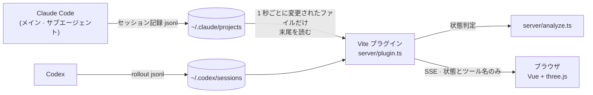

<div align="center">

[한국어](README.md) · [English](README.en.md) · **日本語** · [中文](README.zh.md)

# Agent Office

**Claude Code と Codex のセッションとサブエージェントが今なにをしているかを、3D オフィスのキャラクターで見せるローカルダッシュボード**

メイン Claude が自分の机でタイピングし、任せたサブエージェントたちが隣の席で働き、あなたの返事が必要になると席で吹き出しを出します。


<p><sub>テストデータで構成した画面です。6 セッションと 6 体のサブエージェントを表示し、実際の会話やプロジェクト情報は含みません。</sub></p>

</div>

---

## なぜ作ったか

Claude Code でサブエージェントを何体も動かすと、ターミナルだけでは誰がなにをしているのか、どのセッションがあなたの返事を待っているのかがひと目で分かりません。Agent Office は `~/.claude/projects` のセッション記録を読み、**役割ごとの作業スペース**、**エージェントごとにキャラクターをひとり**割り当てて表示します。Claude Code 側にインストールや設定は不要です。起動しておくだけです。

## 主な機能

- **役割別スペース** — 15.75×14.25のオフィスに企画、バックエンド、フロントエンド、レビュー・コミット、メイン・共用の5区画があり、各6席、合計30席です。最大6セッションを表示します。
- 各区画は向かい合って座ります。企画には丸い会議テーブルとノートPC、図解ボード、デザインにはタブレットとペンがあり、レビュー・コミットは仕切りのない6台のPCを共有します。ボードは装飾です。
- 企画の隣に休憩スペースを置き、カフェはメイン・フロントエンド区画のそば、エレベーターは窓側に配置します。
- 既存のagentTypeを優先し、短いdescriptionで補います。本文やツール入力を追加取得しません。不明な役割は共用区画へ、メインの席を優先します。満席なら区画脇で待機します。ツール変更では移動せず、遅れて役割が判明した場合のみ再配置します。
- **状態が見えるキャラクター** — 作業中は座ってタイピングし、ファイルを読むときは読む姿勢に、返事を待つときは吹き出しが弾み、手の空いたサブエージェントはオフィスを歩き回ります。
- **吹き出しのツールチップ** — 使用中のツール(`Bash`、`Read`、`Edit` …)と、エージェントに任せた作業の説明を表示します。MCP ツールは `playwright · take screenshot` のように読みやすく短縮します。
- **サブエージェントの追跡** — バックグラウンドのエージェントも追いかけ、メインの吹き出しに誰を待っているか(`code-reviewer ×2 を待機中`)を表示します。
- **詳細カード** — キャラクターや名札をクリックすると、状態・ツール・最終アクティビティ・任せたエージェントを表示します。
- **応答なしの検出** — ツールの結果を長く受け取れていないサブエージェントには赤い `応答なし` チップを出します。
- **使用量ゲージ** — トップバーにClaudeの現在のセッション(5 時間)と週間の使用量、リセットまでの残り時間を表示します。
- **サービス選択** — 上部の `すべて | Claude | Codex` でセッションとサブエージェントを絞り込みます。初期値はすべて、選択はブラウザーに保存します。件数と詳細も連動し、使用量はサービス別に表示します。Codexの最新ローカル使用量記録を期間に応じて表示し、記録がない場合や期限切れは `—` です。複数セッションの値は合算しません。新しい記録で更新されます。
- ClaudeとCodexの使用率は、リセット時刻を過ぎると新しい記録が届くまで `—` と表示します。同じ役割の席が空くと、待機中のエージェントが着席します。
- **画面共有用スイッチ** — プロジェクト名を隠せます。
- **4 言語対応** — 한국어・English・日本語・中文。ブラウザの言語に合わせ、HUD から切り替えられます。
- **本文は送らない** — ブラウザに送るのは状態とツール名だけです。会話の内容やツールの入出力はサーバーの外に出ません。

## クイックスタート

### 必要なもの

- [Node.js](https://nodejs.org) 22.12 以上(22 LTS または 24 以上)
- [Claude Code](https://docs.claude.com/en/docs/claude-code) または [Codex](https://openai.com/codex/) を使っているマシン(セッション記録を同じマシンから読みます)

### インストールと起動

```bash
git clone <this-repo-url> agent-office
cd agent-office
npm install
npm run dev
```

ブラウザで <http://localhost:5180> を開き、いつも通り Claude Code で作業すると、オフィスにキャラクターが入ってきます。

> [!NOTE]
> セッションデータは開発サーバーの Vite プラグインが配信します。`npm run build` の成果物(静的ファイル)だけでは動作しません。

### トラブルシューティング

- **`vite: command not found`** — 依存パッケージがまだインストールされていません。プロジェクトのフォルダーで `npm ci` を実行してください。
- **`Cannot find module @rollup/rollup-…`** または esbuild のプラットフォームエラー — 別のマシン(例: Apple Silicon の Mac ↔ Intel の Mac)から `node_modules` ごとコピーしたときに起きます。`rm -rf node_modules && npm ci` で入れ直してください。プロジェクトを移すときは `node_modules` と `dist` を除いてコピーします。

`npm run dev` は起動前にこの 2 つのケースを検査し(`scripts/check-deps.mjs`)、やるべきことを表示します。

## 画面の見かた

| キャラクターの様子 | 意味 |
|------|------|
| 席でタイピング、右のモニターのターミナルがスクロール | ツールを実行中、または回答を作成中(`Bash` のときはターミナルが速く流れます) |
| 席で読む姿勢、ターミナルがゆっくり流れる | `Read`・`Grep`・`Glob` などの読み取りツールを実行中 |
| `•••` の吹き出しが名札と一緒に弾む | あなたの返事を待っている(`AskUserQuestion`、または回答を終えてあなたの番) |
| 席を離れてオフィスを歩き回る、またはティーテーブルに座って休む | サブエージェントが 2 分以上なにも記録していない(居眠り) |
| 休憩スペースのソファ・椅子に座る、コーヒーを飲む | `MAIN_STAYS_SEATED = false` のときのみ: メインが 1 分以上あなたの返事を待っている |
| 赤い `応答なし` チップ | サブエージェントが 12 分以上ツールの結果を受け取れていない |
| ドアから出ていく | セッションまたはエージェントが終了した |

- **名札の点・足元のリング**はセッション、**床の色**は役割を表します。2D・3Dとも服の色はエージェントに応じて変わります。
- 背面の二面の窓には、高層階から川と橋、両岸の街並みを見下ろす景色が広がります。二面の窓は半径 3 の曲面ガラスでつながり、中央の柱なしで川沿いの景色がつながります。特定のランドマークを強調せず、川・橋・建物のバランスを保ちます。`?hour=18&window=square` で直角の窓と比較できます。厚みのある窓枠と内側の窓台が室内の境界を作ります。昼・夕焼け・夜の画像が時刻に合わせて切り替わり、夕焼け時には室内の光も暖かくなります。共通の投影で画像の比率と水平線を保ち、画像読み込み時と時刻変更時だけ背景を更新します。`?hour=18` で夕焼け、`?hour=22` で夜を表示できます。[夕焼け](docs/screenshot-sunset.png) · [夜](docs/screenshot-night.png)
- デスクは丸みのあるオーク天板、白い板状の脚、セージ色のマットを組み合わせ、座席間隔と天板の高さを維持しています。
- 休憩スペースを企画の隣へ移して回転し、ソファと椅子がテーブルを囲みます。ソファと椅子は丸い肘掛け、低い背もたれ、独立クッション、木製脚のセージグリーンの布張りで、座面の高さと間隔を維持します。
- 企画会議室をAPI区画に近づけ、作業区画をまとめて少し右へ移し、モニター正面が見える席から割り当てます。各デスクに薄い銀色のキーボード、白いマウスとiMac風の一体型画面置き、企画にはノートPC、レビュー区画は仕切りのない6席です。カフェのバーは画面左に寄せ、横に広く奥行きを浅くし、テーブルまでカフェのラグを広げ、間隔を空け、マシン同士にも余裕を持たせました。バリスタはコーヒーを準備し、カウンターにケトルを3台置きます。スタンドライトと鉢植えは置いていません。
- 既定は承認済みのイメージを基に生成した **2Dスプライト**です。方向別画像、歩行4段階・タイピング2フレーム、着席・コーヒー姿を使用します。`AGENT_LOOKS` の `cap: true` で帽子を選択。`glasses: true` は従来の3Dキャラクターを使用し、`CHARACTER_RENDER_STYLE` を `'3d'` にすると全員を3Dに戻せます。[2D拡大](docs/screenshot-sprite-closeup.png) · [帽子の表示](docs/screenshot-sprite-cap.png)
- 休憩スペースのラグ、テーブル、椅子と着席位置も一緒に移動します。
- 会議テーブルにはノートPCを置きます。作業中のデスクは着席者の左に明るいWeb画面、右にターミナルを表示します。エレベーターは滑らかに動き、到着したキャラクターは順番に降ります。
- **マウスホイール**で拡大・縮小、右上のボタンで全画面にします。
- **キャラクターや名札をクリック**すると詳細カードが開きます。空いている所をクリックするか `Esc` で閉じます。
- 右上の**言語選択**で表示言語を切り替えます。最初はブラウザの言語に従い(未対応の言語なら英語)、選んだ言語はブラウザに保存されます。
- 右上の **`プロジェクト名` スイッチ**をオフにすると、ゾーン表示とカードからプロジェクト名を隠します。この設定も保存されます。
- ブラウザのタブが隠れている間は接続と描画を止め、表示されると再開します。

## 仕組み



1. Codex は `~/.codex/sessions/YYYY/MM/DD/rollout-*.jsonl` を読みます。`CODEX_HOME` で保存先を変更でき、`parent_thread_id` でサブエージェントを親に関連付けます。Claude Code はセッションごとに `~/.claude/projects/<プロジェクト>/<セッションID>.jsonl` に、サブエージェントごとに `<セッションID>/subagents/agent-<ID>.jsonl` と `agent-<ID>.meta.json`(種類・説明)に記録を残します。
2. セッションファイル全体の探索は 5 秒ごと、発見済みの最近のファイルの変更確認と状態更新は 1 秒ごとに行います。新しいセッションや長い休止後に再開したセッションの表示には最大 5 秒かかります。開発サーバーのプラグインが直近 30 分以内に変更されたセッション(と、いま開いているセッション)だけを選んでファイルの末尾を読み、結果待ちのツールがあるか・回答を終えたかで状態を決めます。変わっていないファイルは読み直しません。Codex の識別情報もキャッシュし、ファイルの置換や書き直し時に更新します。
3. Codex はタスクの開始・完了イベントと最終記録時刻で状態を判定します。Claude Code がプロセスごとに残す `~/.claude/sessions/<pid>.json` で、セッションがまだ開いているかを確認します。
4. 状態が変わったときだけ SSE でブラウザに送り、ブラウザはそのスナップショットでオフィスを描きます。タブをいくつ開いても、サーバーはタイマーひとつで一度だけ読みます。

<details>
<summary><b>状態判定のルール(詳細)</b></summary>

判定は `server/analyze.ts` の純粋関数が担当し、`server/analyze.spec.ts` で検証しています。

| 状態 | 条件 |
|------|------|
| 作業中 | 結果がまだ来ていない `tool_use` がある、または回答を作成中 |
| 待機 | 待っているツールが `AskUserQuestion`、またはメインが回答を終えてあなたの番 |
| 居眠り | 最後の記録から 120 秒以上なにもない |
| 応答なし | サブエージェントが 12 分以上ツールの結果を受け取れていない。Bash の最大タイムアウト(10 分)より長く取り、サブエージェントをさらに起動する `Agent`・`Task`・`Workflow` は除外 |
| 退席 | 下の終了条件 |

- **回答の終了**は、`text` ブロックがあり `stop_reason` が `end_turn`・`stop_sequence`・`max_tokens` のときだけです。Claude Code はひとつの応答を複数行に分けて記録する(thinking の行 → 1〜3 秒後に `tool_use` の行)ため、ツール呼び出しがないだけでは終了とみなしません。
- **サブエージェントの終了**は、`SubagentHandback` が成功の結果を受け取ったとき、または回答終了の行を残したときです。その後に作業が再開すると作業中に戻ります。
- **メインの退席**は、そのセッションを使っていた Claude Code のプロセスが終了したとき(ウィンドウを閉じた、または `/clear` などで別のセッションに移った)です。プロセスが生きている間はどれだけ静かでも席を守り、できたばかりのセッションには 30 秒の猶予があります。プロセス情報を読めない環境(古いバージョンなど)では、待っているツールがないまま 10 分以上静かだと退席します。
- 終了したサブエージェントは退場の演出のため 60 秒間表示を続けます。プロセスが終了したセッションのサブエージェントは一緒にすぐ退場します。
- **サブエージェントが作業している間のメイン**は、メインの記録が待機・居眠りに見えても作業中(`Agent`)とみなします。バックグラウンドのエージェントは `Agent` の結果がすぐに返るため、メインの記録だけではあなたの番に見えてしまうからです。
- **サブエージェント名**は `meta.json` の `agentType` です。jsonl が meta より先にできた場合は、meta が届くまで最大 5 秒待ってから表示します。
- **プロジェクト名**はセッション記録の最初の `cwd`(セッションを始めたフォルダー)の最後の部分です。それ以降の `cwd` はシェルの `cd` に合わせて変わるので使いません。

</details>

<details>
<summary><b>ゾーンが足りないとき</b></summary>

役割区画とは別に、セッション表示枠は6つです。生きているセッションがそれより多いと HUD に案内を出し、次の順でゾーンを割り当てます。

1. 空いたゾーンは作業中のセッション(メインまたはサブエージェントが作業中)→ 最近の活動順に埋めます。
2. ゾーンがすべて埋まっていて作業中のセッションがあふれている場合は、作業していないセッションのうち最も長く静かなセッションのキャラクターが退場し、そのゾーンを譲ります。
3. 作業中のセッション同士は押し出し合いません(活動時刻が変わるたびに席が入れ替わらないように)。

</details>

## 設定

### 自分のプロジェクトに合わせる

どのプロジェクトのセッション・サブエージェントも**設定なしで**表示されます。変えたい値はすべて [`src/agent-office/office.config.ts`](src/agent-office/office.config.ts) のひとつのファイルにあります。

| 設定 | 内容 | 空のとき |
|------|------|------|
| `CHARACTER_RENDER_STYLE` | キャラクター表示方式 | `'sprite'` は2D、`'3d'` は従来の3Dモデル |
| `AGENT_LOOKS` | 種類別のモデル・帽子・眼鏡・服色 | 2Dは服色と帽子を選択可能。眼鏡は3Dモデルで表示 |
| `SEAT_OF_TYPE` | エージェントの種類ごとの希望の席(0〜5) | `SEAT_OTHER` の席 → 空いている席 |
| `AGENT_NAMES` | 名札に表示する名前 | `agentType` そのまま。プラグインのエージェント(`feature-dev:code-reviewer`)は `code-reviewer` |
| `OFFICE_ART` | ソファの上の額の絵(`'seaside'` 海、`'skyline'` 夕焼けの団地のピクセルアート) | `null` なら `OFFICE_SIGN` の文字 |
| `OFFICE_SIGN` | 壁の額の文字 | 両方空なら額なし |
| `MAIN_STAYS_SEATED` | メイン Claude が常に席に座っている(既定 `true`) | `false` なら待っている間は休憩スペースへ行き、長く静かだと歩き回る |

```ts
// 例: 自分のエージェントに名前と席を決める
export const AGENT_NAMES: Record<string, string> = {
  'general-purpose': '汎用',
  'feature-dev:code-reviewer': 'レビュアー',
}
export const SEAT_OF_TYPE: Record<string, number> = { 'feature-dev:code-reviewer': 4 }
```

### 使用量のリアルタイム更新(任意)

トップバー は通常、Claude Code が `~/.claude.json` に保存している使用量を表示しますが、この値はときどきしか更新されません。Claude Code はステータスラインを描くたびに最新の使用量をステータスラインのコマンドに渡すので、ステータスラインの前に小さなブリッジを挟むと トップバーもすぐに更新されます。

```bash
npm run statusline:install    # インストール: 今のステータスラインのコマンド(claude-hud など)を保存してブリッジで包む
npm run statusline:uninstall  # アンインストール: 元のステータスラインに戻す
```

- ブリッジ(`scripts/statusline-bridge.mjs`)は使用率の数値だけを `~/.claude/agent-office-usage.json` に書き、元のステータスラインのコマンドを同じ入力で実行して出力をそのまま返します。ステータスラインの見た目は変わりません。
- インストール時に `settings.json` を `settings.json.agent-office-backup` にバックアップし、`statusLine` のコマンドだけを変更します。
- プロジェクトのフォルダーを移動するとブリッジのパスが変わるので、もう一度インストールしてください。

### ポート

既定のポートは **5180** です。ほかの Vite プロジェクト(既定 5173)と重ならないように選びました。すでに使われている場合は別のポートに移らず失敗します(`strictPort`)。変えるには [`vite.config.ts`](vite.config.ts) の `server.port` を編集します。

### セッション記録の場所

既定は `~/.claude/projects`(Windows では `%USERPROFILE%\.claude\projects`)です。`CLAUDE_CONFIG_DIR` で Claude Code の設定フォルダーを移している場合は、開発サーバーを起動するシェルにも同じ値を設定してください。

```bash
CLAUDE_CONFIG_DIR=/path/to/claude-config npm run dev
```

> [!TIP]
> **WSL** の中で Claude Code を使っているなら、Agent Office も WSL の中で起動してください。Windows 側で起動すると、WSL の `~/.claude` ではなく Windows のユーザーフォルダーを読みます。

## セキュリティとプライバシー

セッション記録には会話の原文やツールの入出力が含まれ、機密情報が混ざることがあります。そのため次のことを守ります。

- ブラウザに送るのは **セッション ID・プロジェクト名・エージェント ID・エージェントの種類・説明・ツール名・時刻・状態・使用率(%)とリセット時刻** だけです。
- 使用量は Claude Code が `~/.claude.json` に保存している値(`cachedUsageUtilization`)から数値だけを読みます。ログイン情報は読まず API も呼ばないため、Claude Code が使用量を取得し直したときに トップバーも更新されます(ステータスラインのブリッジを入れると、ステータスラインが描かれるたびに更新)。メッセージ本文やツールの入力・結果は送りません。
- サーバーは `localhost` にのみバインドし、リクエストのリモートアドレスと `Host` ヘッダーが両方ともループバックのときだけ応答します(それ以外は `403`)。DNS リバインディングで外部のページから読まれることも防ぎます。
- ログイン機能はないので、サーバーを外部に公開しないでください。

## 既知の制限

- **セッション記録の形式は公開仕様ではありません。** Claude Code のバージョンによって変わることがあり、そうなると状態判定がずれる可能性があります。知らないフィールドは無視し、壊れた行は読み飛ばします。
- 同時表示は最大6セッションなので、7つ以上開いていると一部は表示されません。
- Windows で起動した Agent Office から WSL 内の Claude Code を見る場合など、プロセスを確認できないときはセッションが開いているものとみなします。
- サブエージェントが強制終了されてから `応答なし` が出るまで 12 分かかります(長いビルドを誤検出しないための余裕)。
- カメラが座ったキャラクターを後ろから見下ろす構図なので、タイピングの動きは正面から見るほどはっきりしません。

## 開発

| コマンド | 内容 |
|------|------|
| `npm run dev` | 開発サーバー(<http://localhost:5180>) |
| `npm test` | 単体テスト(Vitest) |
| `npm run typecheck` | 型チェック(画面は `vue-tsc`、サーバー・設定は `tsc`) |
| `npm run build` | 静的ビルド(型・バンドルの確認用) |

```
index.html, src/main.ts             シングルページのエントリー
src/App.vue                         HUD · SSE 接続 · 詳細カード · 表示状態の処理
src/i18n.ts                         画面の文言辞書(韓国語 · 英語 · 日本語 · 中国語)
scripts/check-deps.mjs              npm run dev の前に、依存パッケージがこのマシン用に入っているかを検査
src/agent-office/scene.ts           three.js シーン — キャラクター · 移動 · 吹き出し · ゾーン割り当て
src/agent-office/layout.ts          オフィスの配置(純粋データ) · 経路探索
src/agent-office/staticMeshes.ts    固定デスク・モニターのインスタンシング
src/agent-office/usage.ts        トップバー 画面(使用量・表示計算)
src/agent-office/exterior.ts        ソウル川沿いのパノラマ（昼・夕焼け・夜、比率を保つ投影）
src/agent-office/windowView.ts      時刻ごとの空の色と夜の強さ
src/agent-office/assets.ts          GLB ローダー · アニメーションクリップの合成(タイピングなど)
src/agent-office/office.config.ts   プロジェクトごとの設定
src/agent-office/assets/            Kenney の 3D モデル(CC0)
server/plugin.ts                    Vite プラグイン — セッションのスキャン · SSE · ループバック検査
server/sessionFiles.ts              セッションファイル索引 — 5 秒ごとの探索と変更確認
server/analyze.ts                   状態判定の純粋関数
```

テストはフレーム間隔ごとの移動距離、固定家具のインスタンシング、状態判定のルール、ゾーンの割り当て、配置(通路がふさがっていないか、モニターが机に収まるか)、吹き出しの文言、言語辞書(すべての言語が同じキーを持つか)、キャラクターの色のコントラストを検査します。3D 画面が変わる修正は `npm run dev` で起動して目でも確認してください。

## コントリビュート

Issue も Pull Request も歓迎します。

- Claude Code のバージョンが変わって状態がおかしく見えるときは、どんな状況でどう見えたかと Claude Code のバージョンを書いて Issue で知らせてください。セッション記録を添付する場合は、会話の内容を必ず消してからにしてください。
- PR の前に `npm test` と `npm run typecheck` が通ることを確認してください。
- 状態判定のルールを変える場合は、その状況を再現するテストを `server/analyze.spec.ts` に一緒に追加してください。
- 画面の文言を追加するときは `src/i18n.ts` の 4 言語すべての辞書に入れてください(ひとつでも欠けると型チェックが失敗します)。新しい言語も辞書をひとつ追加するだけです。

## クレジットとライセンス

- コード: [MIT](LICENSE)
- 3D モデル: [Kenney](https://kenney.nl) の **Furniture Kit 2.0**・**Mini Characters 1.0** — [CC0 1.0](src/agent-office/assets/LICENSE-kenney.txt)
- Claude と Claude Code は Anthropic の商標です。本プロジェクトは Anthropic とは関係のない非公式ツールです。
