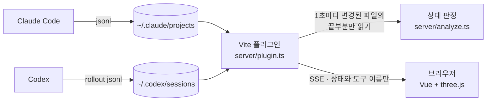

<div align="center">

**한국어** · [English](README.en.md) · [日本語](README.ja.md) · [中文](README.zh.md)

# Agent Office

**Claude Code와 Codex 세션이 지금 무엇을 하는지, 3D 사무실 속 캐릭터로 보여 주는 로컬 대시보드**

메인 에이전트가 책상에서 타이핑하고, 맡긴 서브에이전트들이 옆자리에서 일하고, 내 답이 필요하면 자리에서 말풍선을 띄웁니다.


<p><sub>테스트 데이터로 구성한 화면입니다. 세션 4개와 서브에이전트 6개를 표시하며 실제 대화나 프로젝트 정보는 포함하지 않습니다.</sub></p>

</div>

---

## 왜 만들었나

Claude Code 나 Codex 세션을 여러 개 돌리면 터미널만 봐서는 누가 무엇을 하고 있는지, 어느 세션이 내 답을 기다리는지 한눈에 알기 어렵습니다. Agent Office 는 Claude Code 와 Codex 의 로컬 세션 기록을 읽어 **세션마다 사무실 구역 하나**, **에이전트마다 캐릭터 하나**로 보여 줍니다. 설치할 것도 설정할 것도 없습니다. 띄워 두기만 하면 됩니다.

## 주요 기능

- **세션별 구역** — 동시에 돌아가는 세션을 최대 4개 구역에 나눠 보여 줍니다. 구역이 모자라면 일하는 세션을 우선합니다.
- **상태가 보이는 캐릭터** — 작업 중이면 앉아서 타이핑하고, 파일을 읽을 땐 읽는 자세를, 답을 기다리면 말풍선이 통통 튀고, 한가한 서브에이전트는 사무실을 돌아다닙니다.
- **말풍선 도구 칩** — 지금 쓰는 도구(`Bash`, `Read`, `Edit` …)와 에이전트에게 맡긴 일의 설명을 보여 줍니다. MCP 도구는 `playwright · take screenshot` 처럼 읽기 좋게 줄입니다.
- **서브에이전트 추적** — 백그라운드 에이전트까지 따라가며, 메인 말풍선에 누구를 기다리는지(`code-reviewer ×2 기다리는 중`) 적습니다.
- **상세 카드** — 캐릭터나 이름표를 누르면 상태·도구·마지막 활동·맡긴 에이전트를 보여 줍니다.
- **응답 없음 감지** — 도구 결과를 너무 오래 못 받은 서브에이전트는 빨간 `응답 없음` 칩으로 표시합니다.
- **사용량 게이지** — 사무실 벽 TV에 현재 세션(5시간)·주간 사용량과 초기화까지 남은 시간을 보여 줍니다.
- **화면 공유용 스위치** — 프로젝트 이름을 숨길 수 있습니다.
- **4개 언어** — 한국어·English·日本語·中文. 브라우저 언어를 따르고 HUD 에서 바꿀 수 있습니다.
- **본문은 절대 안 내보냄** — 브라우저로는 상태와 도구 이름만 보냅니다. 대화 내용·도구 입출력은 서버 밖으로 나가지 않습니다.

## 빠르게 시작하기

### 준비물

- [Node.js](https://nodejs.org) 22.12 이상 (22 LTS 또는 24 이상)
- [Claude Code](https://docs.claude.com/en/docs/claude-code) 또는 [Codex](https://openai.com/codex/) 를 쓰고 있는 컴퓨터 (세션 기록을 같은 컴퓨터에서 읽습니다)

### 설치와 실행

```bash
git clone <this-repo-url> agent-office
cd agent-office
npm install
npm run dev
```

브라우저에서 <http://localhost:5180> 을 엽니다. Claude Code 나 Codex 로 작업하면 사무실에 캐릭터가 들어옵니다.

> [!NOTE]
> 세션 데이터는 dev 서버의 Vite 플러그인이 내려 줍니다. `npm run build` 결과물(정적 파일)만 올려서는 동작하지 않습니다.

### 문제 해결

- **`vite: command not found`** — 의존성을 아직 설치하지 않았습니다. 프로젝트 폴더에서 `npm ci` 를 실행하세요.
- **`Cannot find module @rollup/rollup-…`** 또는 esbuild 플랫폼 오류 — 다른 컴퓨터(예: Apple Silicon 맥 ↔ 인텔 맥)에서 `node_modules` 를 통째로 복사해 왔을 때 납니다. `rm -rf node_modules && npm ci` 로 다시 설치하세요. 프로젝트를 옮길 때는 `node_modules` 와 `dist` 를 빼고 복사하면 됩니다.

`npm run dev` 는 실행 전에 이 두 경우를 검사해(`scripts/check-deps.mjs`) 해야 할 일을 알려 줍니다.

## 화면 보는 법

| 캐릭터 모습 | 뜻 |
|------|------|
| 자리에 앉아 타이핑, 오른쪽 모니터 터미널이 스크롤됨 | 도구를 실행 중이거나 답변을 만드는 중 (`Bash` 면 터미널이 더 빠르게 흐릅니다) |
| 자리에 앉아 읽는 자세, 터미널이 천천히 흐름 | `Read`·`Grep`·`Glob` 같은 읽기 도구 실행 중 |
| 말풍선 `•••` 이 이름표와 함께 튐 | 사용자 답을 기다리는 중 (`AskUserQuestion` 이거나 답변을 마치고 사용자 차례) |
| 자리를 떠나 사무실을 어슬렁거리거나 티테이블에 앉아 쉼 | 서브에이전트가 2분 넘게 아무 기록이 없음(졸음) |
| 휴게실 소파·의자에 앉거나 커피를 마심 | `MAIN_STAYS_SEATED = false` 일 때만: 메인의 사용자 차례가 1분 넘게 이어짐 |
| 빨간 `응답 없음` 칩 | 서브에이전트가 도구 결과를 12분 넘게 못 받음 |
| 문으로 걸어 나감 | 세션·에이전트가 끝남 |

- **이름표 점·발밑 링·바닥 색**은 세션(구역) 색이고, **옷 색**은 에이전트 종류 색입니다.
- 뒤쪽 두 면의 통유리 너머에는 입체감 있는 픽셀아트로 그린 남산·N서울타워·도시와 한강이 보입니다. 풍경은 창틀 안에서만 이어지며 컴퓨터 시계에 따라 낮·밤이 전환됩니다. 강물에는 작은 픽셀 반사광이 잔잔하게 반짝이고, 배가 가볍게 흔들립니다. 카페 옆과 업무 구역 사이에는 스탠드 조명을 배치했습니다. 저녁부터는 사무실 조명이 조금 어두워지고 스탠드·협탁 램프가 켜져 주변에 따뜻한 불빛이 번집니다. 주소 뒤에 `?hour=18.5` 처럼 시각을 붙이면 그 시각으로 볼 수 있습니다.
- 책상마다 듀얼 모니터가 있습니다. 사람이 앉으면 왼쪽은 디자인 툴 화면, 오른쪽은 터미널이 켜지고, 빈자리는 파란 화면입니다.
- **마우스 휠**로 확대·축소, 오른쪽 위 버튼으로 전체화면을 켭니다.
- **캐릭터나 이름표를 클릭**하면 상세 카드가 열립니다. 빈 곳을 누르거나 `Esc` 로 닫습니다.
- 오른쪽 위 **언어 선택**으로 화면 언어를 바꿉니다. 처음에는 브라우저 언어를 따르고(지원하지 않는 언어면 영어), 고른 언어는 브라우저에 기억됩니다.
- 오른쪽 위 **`프로젝트명` 스위치**를 끄면 구역 표식과 카드에서 프로젝트 이름을 숨깁니다. 이 설정도 브라우저에 기억됩니다.
- 브라우저 탭이 가려지면 연결과 렌더링을 멈추고, 다시 보이면 이어 갑니다.

## 동작 방식



1. Claude Code 는 `~/.claude/projects` 에, Codex 는 `~/.codex/sessions/YYYY/MM/DD/rollout-*.jsonl` 에 세션 기록을 남깁니다. Codex 의 `CODEX_HOME` 환경 변수로 기본 폴더를 바꾼 경우에도 그 경로를 읽습니다. Codex 서브에이전트는 `parent_thread_id` 로 부모 세션에 연결합니다.
2. 전체 세션 파일 탐색은 5초마다, 이미 발견한 최근 파일의 변경 확인과 상태 갱신은 1초마다 수행합니다. 새 세션이나 오래 쉬다가 재개된 세션은 표시되기까지 최대 5초가 걸릴 수 있습니다. dev 서버의 플러그인이 최근 30분 안에 바뀐 세션(과 지금 열려 있는 세션)만 골라 파일 끝부분을 읽고, 결과를 기다리는 도구가 있는지·답변을 마쳤는지로 상태를 정합니다. 파일이 그대로면 다시 읽지 않습니다. Codex 세션의 식별 정보도 캐시하고, 파일이 교체되거나 다시 쓰이면 갱신합니다.
3. Claude Code 는 프로세스별 세션 파일도 확인합니다. Codex 는 완료·시작 이벤트와 마지막 기록 시각으로 상태를 판정합니다.
4. 상태가 바뀔 때만 SSE 로 브라우저에 보내고, 브라우저는 그 스냅샷으로 사무실을 그립니다. 탭을 여러 개 열어도 서버는 타이머 하나로 한 번만 읽습니다.

<details>
<summary><b>상태 판정 규칙 자세히</b></summary>

판정은 `server/analyze.ts` 의 순수 함수가 맡고 `server/analyze.spec.ts` 가 검증합니다.

| 상태 | 조건 |
|------|------|
| 작업 중 | 결과가 아직 오지 않은 `tool_use` 가 있음, 또는 답변을 만드는 중 |
| 대기 | 기다리는 도구가 `AskUserQuestion` 이거나, 메인이 답변을 마치고 사용자 차례 |
| 졸음 | 마지막 기록 뒤 120초 넘게 조용함 |
| 응답 없음 | 서브에이전트가 도구 결과를 12분 넘게 못 받음. Bash 최대 타임아웃(10분)보다 길게 잡았고, 서브를 다시 띄우는 `Agent`·`Task`·`Workflow` 는 제외 |
| 퇴장 | 아래 종료 조건 |

- **답변 종료**는 `text` 블록이 있고 `stop_reason` 이 `end_turn`·`stop_sequence`·`max_tokens` 일 때뿐입니다. Claude Code 는 한 응답을 줄 단위로 나눠 기록해서(thinking 줄 → 1~3초 뒤 `tool_use` 줄) 도구 호출이 없다는 이유만으로 끝났다고 보지 않습니다.
- **서브에이전트 종료**는 `SubagentHandback` 이 성공 결과를 받았거나 답변 종료 줄을 남겼을 때입니다. 그 뒤 작업이 다시 시작되면 작업 중으로 돌아갑니다.
- **메인 퇴장**은 그 세션을 쓰던 Claude Code 프로세스가 끝났을 때(창을 닫았거나 `/clear` 등으로 다른 세션으로 넘어감)입니다. 프로세스가 살아 있으면 아무리 조용해도 자리를 지키고, 막 생긴 세션은 30초 유예를 둡니다. 프로세스 정보를 읽을 수 없는 환경(옛 버전 등)에서는 기다리는 도구 없이 10분 넘게 조용하면 퇴장합니다.
- 끝난 서브에이전트는 퇴장 연출을 위해 60초 동안 더 보여 줍니다. 프로세스가 끝난 세션의 서브에이전트는 함께 바로 나갑니다.
- **서브에이전트가 일하는 동안의 메인**은 메인 기록이 대기·졸음이어도 작업 중(`Agent`)으로 봅니다. 백그라운드 에이전트는 `Agent` 결과가 바로 돌아와 메인 기록만 보면 사용자 차례처럼 보이기 때문입니다.
- **서브에이전트 이름**은 `meta.json` 의 `agentType` 입니다. jsonl 이 meta 보다 먼저 생기는 틈에는 최대 5초까지 meta 를 기다렸다가 보여 줍니다.
- **프로젝트 이름**은 세션 기록의 첫 `cwd`(세션을 시작한 폴더)의 마지막 조각입니다. 그 뒤의 `cwd` 는 셸 `cd` 를 따라 바뀌므로 쓰지 않습니다.

</details>

<details>
<summary><b>구역이 모자랄 때</b></summary>

사무실 구역은 4개입니다. 살아 있는 세션이 더 많으면 HUD 에 안내를 띄우고 다음 순서로 나눕니다.

1. 빈 구역은 일하는 세션(메인이나 서브가 작업 중) → 최근 활동순으로 채웁니다.
2. 구역이 꽉 찼는데 일하는 세션이 밀려나 있으면, 일하지 않는 세션 중 가장 오래 조용한 세션의 캐릭터를 내보내고 그 구역을 넘깁니다.
3. 일하는 세션끼리는 서로 밀어내지 않습니다(활동 시각이 바뀔 때마다 자리가 뒤바뀌지 않도록).

</details>

## 설정

### 내 프로젝트에 맞추기

어떤 프로젝트의 세션·서브에이전트든 **설정 없이** 보입니다. 바꾸고 싶은 값은 모두 [`src/agent-office/office.config.ts`](src/agent-office/office.config.ts) 한 파일에 있습니다.

| 설정 | 내용 | 비워 두면 |
|------|------|------|
| `AGENT_LOOKS` | 에이전트 종류별 캐릭터 모델·옷 색 | 모델은 종류 이름으로, 옷 색은 22가지 후보 중 종류끼리 겹치지 않게 자동으로 고름 |
| `SEAT_OF_TYPE` | 에이전트 종류별 선호 자리(0~5) | `SEAT_OTHER` 자리 → 빈자리 아무 곳 |
| `AGENT_NAMES` | 이름표에 보일 이름 | `agentType` 그대로. 플러그인 에이전트(`feature-dev:code-reviewer`)는 `code-reviewer` |
| `OFFICE_ART` | 독립형 액자 그림(`'seaside'` 바다, `'skyline'` 노을 도시 픽셀아트) | `null` 이면 `OFFICE_SIGN` 글자 |
| `OFFICE_SIGN` | 벽 액자 글자 | 둘 다 비면 액자 없음 |
| `MAIN_STAYS_SEATED` | 메인 Claude 가 늘 자리에 앉아 있음(기본 `true`) | `false` 면 기다리는 동안 휴게실에 가고, 오래 조용하면 돌아다님 |

```ts
// 예: 내 에이전트에 이름과 자리를 정해 주기
export const AGENT_NAMES: Record<string, string> = {
  'general-purpose': '범용',
  'feature-dev:code-reviewer': '리뷰어',
}
export const SEAT_OF_TYPE: Record<string, number> = { main: 5, 'feature-dev:code-reviewer': 4 }
```

### 사용량 실시간 갱신(선택)

벽 TV 는 기본적으로 Claude Code 가 `~/.claude.json` 에 저장해 둔 사용량을 보여 주는데, 이 값은 가끔씩만 갱신됩니다. Claude Code 는 상태줄을 그릴 때마다 상태줄 명령에 최신 사용량을 넘겨 주므로, 상태줄 앞에 작은 브리지를 끼우면 TV 도 바로바로 바뀝니다.

```bash
npm run statusline:install    # 설치: 지금 상태줄 명령(claude-hud 등)을 저장하고 브리지로 감싼다
npm run statusline:uninstall  # 제거: 원래 상태줄로 되돌린다
```

- 브리지(`scripts/statusline-bridge.mjs`)는 사용률 숫자만 `~/.claude/agent-office-usage.json` 에 남기고, 원래 상태줄 명령을 같은 입력으로 실행해 출력을 그대로 내보냅니다. 상태줄 모양은 바뀌지 않습니다.
- 설치할 때 `settings.json` 을 `settings.json.agent-office-backup` 으로 백업하고 `statusLine` 명령 한 줄만 바꿉니다.
- 프로젝트 폴더를 옮기면 브리지 경로가 바뀌므로 다시 설치하세요.

### 포트

기본 포트는 **5180** 입니다. 다른 Vite 프로젝트(기본 5173)와 겹치지 않게 골랐고, 이미 쓰이고 있으면 다른 포트로 넘어가지 않고 실패합니다(`strictPort`). 바꾸려면 [`vite.config.ts`](vite.config.ts) 의 `server.port` 를 고칩니다.

### 세션 기록 위치

Claude Code 는 `~/.claude/projects` (Windows 는 `%USERPROFILE%\.claude\projects`), Codex 는 `~/.codex/sessions` (Windows 는 `%USERPROFILE%\.codex\sessions`) 을 기본으로 씁니다. 데이터 폴더를 옮겼다면 dev 서버를 띄우는 셸에서 `CLAUDE_CONFIG_DIR` 또는 `CODEX_HOME` 을 설정하세요.

```bash
CLAUDE_CONFIG_DIR=/path/to/claude-config npm run dev
```

```bash
CODEX_HOME=/path/to/codex-home npm run dev
```

> [!TIP]
> **WSL** 안에서 Claude Code 를 쓴다면 Agent Office 도 WSL 안에서 띄우세요. Windows 쪽에서 띄우면 WSL 의 `~/.claude` 가 아니라 Windows 사용자 폴더를 읽습니다.

## 보안과 개인정보

세션 기록에는 대화 원문과 도구 입출력이 들어 있어 민감한 정보가 섞일 수 있습니다. 그래서 다음을 지킵니다.

- 브라우저로 보내는 필드는 **세션 ID · 프로젝트 이름 · 에이전트 ID · 에이전트 종류 · 설명 · 도구 이름 · 시각 · 상태 · 사용률(%)과 초기화 시각**뿐입니다.
- 사용량은 Claude Code 가 `~/.claude.json` 에 저장해 둔 값(`cachedUsageUtilization`)에서 숫자만 읽습니다. 로그인 정보는 읽지 않고 API 도 부르지 않으므로, Claude Code 가 사용량을 새로 받아 와야 TV 도 갱신됩니다(상태줄 브리지를 설치하면 상태줄이 그려질 때마다 갱신). 메시지 본문과 도구 입력·결과는 보내지 않습니다.
- 서버는 `localhost` 에만 바인딩하고, 요청의 원격 주소와 `Host` 헤더가 모두 loopback 일 때만 응답합니다(그 밖에는 `403`). DNS 리바인딩으로 외부 페이지가 읽어 가는 것도 막습니다.
- 로그인이 없으므로 서버를 외부에 노출하지 마세요.

## 알려진 한계

- **세션 기록 형식은 안정된 공개 API가 아닙니다.** Claude Code 나 Codex 가 형식을 바꾸면 상태 판정에 영향이 있을 수 있습니다. 모르는 필드는 무시하고 깨진 줄은 건너뜁니다.
- 구역은 4개라 동시에 5개 이상 세션이 열려 있으면 일부는 화면에 안 나옵니다.
- WSL 안의 Claude Code 를 Windows 에서 띄운 Agent Office 로 보는 것처럼 프로세스를 확인할 수 없는 경우에는, 세션이 열려 있는 것으로 봅니다.
- 서브에이전트가 강제 종료되면 `응답 없음` 이 뜨기까지 12분이 걸립니다(긴 빌드를 오탐하지 않으려는 여유).
- 카메라가 앉은 캐릭터를 뒤에서 내려다보는 구조라 타이핑 동작이 앞에서 보는 것만큼 또렷하지 않습니다.

## 개발

| 명령 | 내용 |
|------|------|
| `npm run dev` | dev 서버 (<http://localhost:5180>) |
| `npm test` | 단위 테스트 (Vitest) |
| `npm run typecheck` | 타입 검사 (`vue-tsc` 화면 + `tsc` 서버·설정) |
| `npm run build` | 정적 빌드 (타입·번들 확인용) |

```
index.html, src/main.ts             단일 페이지 진입점
src/App.vue                         HUD · SSE 연결 · 상세 카드 · 가시성 처리
src/i18n.ts                         화면 문구 사전(한국어 · 영어 · 일본어 · 중국어)
scripts/check-deps.mjs              npm run dev 전에 의존성이 이 컴퓨터에 맞게 설치됐는지 검사
src/agent-office/scene.ts           three.js 장면 — 캐릭터 · 이동 · 말풍선 · 구역 배정
src/agent-office/layout.ts          사무실 배치(순수 데이터) · 길찾기
src/agent-office/tvScreen.ts        벽 TV 화면(사용량 게이지·시계)
src/agent-office/exterior.ts        픽셀아트 원경(서울 낮·밤 파노라마 전환)
src/agent-office/windowView.ts      시간대별 하늘색·밤의 세기
src/agent-office/assets.ts          GLB 로더 · 애니메이션 클립 합성(타이핑 등)
src/agent-office/office.config.ts   프로젝트별 설정
src/agent-office/assets/            Kenney 3D 모델 (CC0)
server/plugin.ts                    Vite 플러그인 — 세션 스캔 · SSE · loopback 검사
server/sessionFiles.ts              세션 파일 인덱스 — 5초 탐색 · 최근 파일 변경 확인
server/analyze.ts                   상태 판정 순수 함수
```

테스트는 판정 규칙, 구역 배정, 배치(길이 막히지 않는지, 모니터가 책상에 들어가는지), 말풍선 문구, 언어 사전(모든 언어가 같은 키를 갖는지), 캐릭터 색 대비를 검사합니다. 3D 화면이 바뀌는 수정은 `npm run dev` 로 띄워 눈으로도 확인해 주세요.

## 기여하기

이슈와 PR 모두 환영합니다.

- Claude Code 버전이 바뀌어 상태가 이상하게 보이면, 어떤 상황에서 어떻게 보였는지와 Claude Code 버전을 적어 이슈로 알려 주세요. 세션 기록을 첨부할 때는 대화 내용이 들어 있으니 꼭 지우고 올려 주세요.
- PR 전에 `npm test` 와 `npm run typecheck` 가 통과하는지 확인해 주세요.
- 판정 규칙을 바꾸면 `server/analyze.spec.ts` 에 그 상황을 재현하는 테스트를 함께 넣어 주세요.
- 화면 문구를 추가할 때는 `src/i18n.ts` 의 네 언어 사전에 모두 넣어 주세요(하나라도 빠지면 타입 검사가 실패합니다). 새 언어도 사전 하나를 추가하면 됩니다.

## 크레딧과 라이선스

- 코드: [MIT](LICENSE)
- 3D 모델: [Kenney](https://kenney.nl) 의 **Furniture Kit 2.0** · **Mini Characters 1.0** — [CC0 1.0](src/agent-office/assets/LICENSE-kenney.txt)
- Claude 와 Claude Code 는 Anthropic 의 상표입니다. 이 프로젝트는 Anthropic 과 관련이 없는 비공식 도구입니다.
