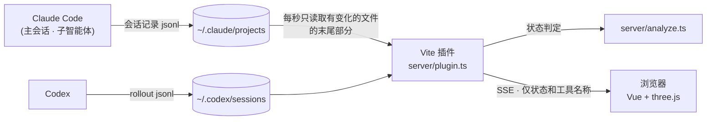

<div align="center">

[한국어](README.md) · [English](README.en.md) · [日本語](README.ja.md) · **中文**

# Agent Office

**用 3D 办公室里的角色，展示 Claude Code 和 Codex 会话和子智能体此刻在做什么的本地仪表盘**

主 Claude 在自己的办公桌前打字，你委派的子智能体在旁边的工位上工作，需要你回复时，它会在座位上冒出对话气泡。


<p><sub>画面使用模拟测试数据，显示六个会话和六个子智能体，不包含真实对话或项目信息。</sub></p>

</div>

---

## 为什么做这个

在 Claude Code 中同时运行多个子智能体时，只看终端很难一眼看出谁在做什么、哪个会话在等你回复。Agent Office 读取 `~/.claude/projects` 中的会话记录，**每种角色对应一个工作区**，**每个智能体对应一个角色**。无需在 Claude Code 中安装或配置任何东西，开着它就行。

## 主要功能

- **按角色划分空间** — 18×18办公室分为规划、API/后端、设计、审查/提交验证、主代理/公共区五区，每区六座，共30座，最多显示六个会话。
- 各区座位面对面布置。规划区有圆角会议桌、笔记本和图解白板；设计区有绘图板和笔；审查与提交代理共用开放的六台电脑工位。白板仅供装饰。
- 规划会议区移至右侧窗边原API区域，API与后端移至中间右侧原空闲区域；原规划区保持空置。
- 优先依据已有agentType，再参考简短description。不会额外收集正文或工具输入。未知角色进入公共区，主代理优先使用座位。满座时在相应区旁站立。工具变化不会触发移动，迟到的角色元数据可触发一次重新分配。
- **能看出状态的角色** — 工作时坐着打字，读取文件时换成阅读姿势，等你回复时气泡会跳动，空闲的子智能体会在办公室里走动。
- **气泡中的工具标签** — 显示正在使用的工具（`Bash`、`Read`、`Edit` …）以及委派给智能体的任务说明。MCP 工具会缩写成易读的形式，例如 `playwright · take screenshot`。
- **子智能体追踪** — 连后台智能体也会追踪，并在主 Claude 的气泡中写明正在等谁（`正在等待 code-reviewer ×2`）。
- **详情卡片** — 点击角色或名牌，可查看状态、工具、最近活动和委派的智能体。
- **无响应检测** — 长时间收不到工具结果的子智能体会显示红色的 `无响应` 标签。
- **用量仪表** — 顶部栏显示当前会话（5 小时）和每周用量，以及距重置的剩余时间。
- **服务选择** — 顶部的 `全部 | Claude | Codex` 筛选会话及其子代理，默认全部，选择保存在浏览器中。数量和详情同步筛选，用量按服务分别展示。Codex显示最新本地限额记录，并按实际周期标注。缺失或过期时显示 `—`；新记录产生后更新，不累加多个会话的百分比。
- Claude和Codex的用量过期后显示 `—`，直到收到新记录。同一角色区域出现空位时，等待中的代理会入座。
- **屏幕共享开关** — 可以隐藏项目名称。
- **支持 4 种语言** — 한국어 · English · 日本語 · 中文。默认跟随浏览器语言，也可以在 HUD 中切换。
- **绝不发送正文** — 发送到浏览器的只有状态和工具名称。对话内容和工具的输入输出不会离开服务器。

## 快速开始

### 环境要求

- [Node.js](https://nodejs.org) 22.12 或更高版本（22 LTS 或 24 及以上）
- 正在使用 [Claude Code](https://docs.claude.com/en/docs/claude-code) 或 [Codex](https://openai.com/codex/) 的电脑（从同一台电脑读取会话记录）

### 安装与运行

```bash
git clone <this-repo-url> agent-office
cd agent-office
npm install
npm run dev
```

在浏览器中打开 <http://localhost:5180>，然后像平常一样使用 Claude Code，角色就会走进办公室。

> [!NOTE]
> 会话数据由开发服务器上的 Vite 插件提供。仅部署 `npm run build` 的产物（静态文件）无法运行。

### 常见问题

- **`vite: command not found`** — 尚未安装依赖。请在项目文件夹中运行 `npm ci`。
- **`Cannot find module @rollup/rollup-…`** 或 esbuild 平台错误 — 从另一台电脑（例如 Apple Silicon Mac ↔ Intel Mac）整个复制了 `node_modules` 时会出现。请用 `rm -rf node_modules && npm ci` 重新安装。迁移项目时，复制时不要包含 `node_modules` 和 `dist`。

`npm run dev` 启动前会检查这两种情况（`scripts/check-deps.mjs`），并提示应该怎么做。

## 怎么看界面

| 角色的样子 | 含义 |
|------|------|
| 坐在工位上打字，右侧显示器的终端在滚动 | 正在运行工具或组织回答（`Bash` 时终端滚动得更快） |
| 坐在工位上呈阅读姿势，终端缓慢滚动 | 正在运行 `Read`、`Grep`、`Glob` 等读取类工具 |
| `•••` 气泡和名牌一起跳动 | 正在等你回复（`AskUserQuestion`，或已经回答完、轮到你了） |
| 离开工位在办公室里走动，或坐到茶桌旁休息 | 子智能体超过 2 分钟没有任何记录（打盹） |
| 坐在休息区的沙发或椅子上，或在喝咖啡 | 仅在 `MAIN_STAYS_SEATED = false` 时：主会话等你回复超过 1 分钟 |
| 红色 `无响应` 标签 | 子智能体超过 12 分钟没有收到工具结果 |
| 走出门 | 会话或智能体已结束 |

- **名牌圆点和脚下圆环**表示会话，**地板颜色**表示角色区。2D和3D角色的服装颜色随代理变化。
- 后方两面玻璃窗共享从高层俯瞰河流、桥梁和两岸城市建筑的全景。两面窗通过半径为 3 的曲面玻璃相连，中央没有立柱遮挡，河流、桥梁与城市建筑均衡呈现，不突出特定地标。使用 `?hour=18&window=square` 可比较直角窗。加厚窗框和内侧窗台勾勒室内边界。白天、夕阳和夜景随时钟过渡，夕阳时室内日光也会变暖。统一投影保持图像比例和连续的地平线，仅在图片加载或时间变化时更新背景。使用 `?hour=18` 查看夕阳，`?hour=22` 查看夜景。[夕阳](docs/screenshot-sunset.png) · [夜景](docs/screenshot-night.png)
- 办公桌采用圆角橡木桌面、白色板式支撑和鼠尾草绿桌垫，保留原有座位间距与桌面高度。
- 休息区向咖啡吧移动2.25，保留通往茶桌的通道。沙发和单人椅改为鼠尾草绿布艺、圆润扶手、低靠背、独立坐垫与木脚，保持座面高度及间距。
- 企划会议区靠近API区，工作区适当靠拢并略向右移动，优先分配能看到显示器正面的座位。每个台式工位配一块薄银色键盘、银色显示器支架和一台Mac mini风格主机；企划使用笔记本，审核区开放并设有六个工位。咖啡吧略向画面左侧移动，加宽并缩短进深，扩大地毯覆盖茶桌，并在茶桌及设备之间留出间距，台面上设有三个水壶，咖啡师会准备咖啡，暂不摆放落地灯和盆栽。
- 默认使用根据确认的概念图生成的 **2D精灵**，包含不同方向、四阶段行走与两帧打字、坐姿和拿咖啡姿势。在 `AGENT_LOOKS` 设置 `cap: true` 可戴帽；`glasses: true` 使用原有3D角色。将 `CHARACTER_RENDER_STYLE` 设为 `'3d'` 可恢复全部3D模型。[2D实际画面](docs/screenshot-sprite-closeup.png) · [戴帽画面](docs/screenshot-sprite-cap.png)
- 休息区从窗边向室内移动0.45，为沙发背后留出空间；地毯、桌椅及坐姿位置同步移动。
- 设计工位的键盘居中，绘图板和笔放在就坐者左侧；面对面的两排工位按各自朝向镜像布置。
- 会议桌使用笔记本电脑，审查与提交区设有六台电脑。
- 用**鼠标滚轮**缩放，右上角的按钮切换全屏。
- **点击角色或名牌**打开详情卡片。点击空白处或按 `Esc` 关闭。
- 右上角的**语言选择**可以切换界面语言。默认跟随浏览器语言（不支持的语言则显示英语），所选语言会保存在浏览器中。
- 关闭右上角的 **`项目名称` 开关**，区域标签和卡片中将隐藏项目名称。该设置同样会被保存。
- 浏览器标签页被隐藏时会暂停连接和渲染，重新显示后继续。

## 工作原理



1. Codex 读取 `~/.codex/sessions/YYYY/MM/DD/rollout-*.jsonl`，可通过 `CODEX_HOME` 更改目录，并根据 `parent_thread_id` 关联父子会话。Claude Code 会为每个会话写入 `~/.claude/projects/<项目>/<会话ID>.jsonl`，为每个子智能体写入 `<会话ID>/subagents/agent-<ID>.jsonl` 和 `agent-<ID>.meta.json`（类型和说明）。
2. 每 5 秒扫描全部会话文件，每秒检查已发现的近期文件是否变化并更新状态。新会话或长时间暂停后恢复的会话最多需要 5 秒才会显示。开发服务器上的插件只挑选最近 30 分钟内有修改的会话（以及当前打开着的会话），读取文件末尾，根据是否有等待结果的工具、回答是否结束来判定状态。没有变化的文件不会重复读取。Codex 的身份元数据也会缓存，文件被替换或重写时会更新缓存。
3. Codex 根据任务开始、完成事件以及最后记录时间判断状态。通过 Claude Code 为每个进程写入的 `~/.claude/sessions/<pid>.json` 确认会话是否仍然打开。
4. 只在状态发生变化时通过 SSE 推送到浏览器，浏览器根据快照绘制办公室。即使打开多个标签页，服务器也只用一个定时器读取一次。

<details>
<summary><b>状态判定规则详解</b></summary>

判定由 `server/analyze.ts` 中的纯函数负责，并由 `server/analyze.spec.ts` 验证。

| 状态 | 条件 |
|------|------|
| 工作中 | 有尚未返回结果的 `tool_use`，或正在组织回答 |
| 等待 | 等待中的工具是 `AskUserQuestion`，或主会话已经回答完、轮到你了 |
| 打盹 | 距最后一条记录超过 120 秒没有任何动静 |
| 无响应 | 子智能体超过 12 分钟没有收到工具结果。设得比 Bash 最大超时（10 分钟）更长；会再启动子智能体的 `Agent`、`Task`、`Workflow` 除外 |
| 已离开 | 见下方的结束条件 |

- **回答结束**仅指存在 `text` 块且 `stop_reason` 为 `end_turn`、`stop_sequence` 或 `max_tokens` 的情况。Claude Code 会把一次响应拆成多行记录（先是 thinking 行，1~3 秒后才是 `tool_use` 行），因此不会仅因为没有工具调用就判定为结束。
- **子智能体结束**是指 `SubagentHandback` 收到成功结果，或写下了回答结束的行。之后如果重新开始工作，会回到工作中。
- **主会话离开**是指使用该会话的 Claude Code 进程已结束（关闭了窗口，或通过 `/clear` 等切换到了其他会话）。只要进程还在，无论多安静都会留在座位上；刚创建的会话有 30 秒宽限期。在无法读取进程信息的环境（旧版本等）中，若没有等待中的工具且安静超过 10 分钟则离开。
- 已结束的子智能体会为离场动画再显示 60 秒。进程已结束的会话，其子智能体也会随之立即离开。
- **子智能体工作期间的主会话**，即使自身记录看起来是等待或打盹，也视为工作中（`Agent`）。因为后台智能体的 `Agent` 结果会立即返回，仅看主会话的记录会像是轮到你了。
- **子智能体名称**取自 `meta.json` 中的 `agentType`。如果 jsonl 比 meta 先出现，会最多等待 5 秒，等 meta 到了再显示。
- **项目名称**取会话记录中第一个 `cwd`（会话启动时所在的文件夹）的最后一段。之后的 `cwd` 会随 shell 的 `cd` 改变，因此不使用。

</details>

<details>
<summary><b>区域不够时</b></summary>

角色区与会话显示名额分开，最多显示六个会话。存活的会话更多时，HUD 会显示提示，并按以下顺序分配区域：

1. 空区域优先给正在工作的会话（主会话或子智能体在工作），其次按最近活动排序。
2. 如果区域已满而仍有正在工作的会话被挤在外面，则让不在工作的会话中最久没有动静的那个会话的角色离场，把区域让出来。
3. 正在工作的会话之间不会互相挤占（避免活动时间一变座位就来回调换）。

</details>

## 配置

### 适配你的项目

任何项目的会话和子智能体都**无需配置**即可显示。所有可调整的值都集中在 [`src/agent-office/office.config.ts`](src/agent-office/office.config.ts) 这一个文件中。

| 设置 | 作用 | 留空时 |
|------|------|------|
| `CHARACTER_RENDER_STYLE` | 角色呈现方式 | `'sprite'` 为2D图像，`'3d'` 为原有3D模型 |
| `AGENT_LOOKS` | 按类型设置模型、帽子、眼镜和服装颜色 | 2D可设置服装颜色和帽子；眼镜使用3D角色 |
| `SEAT_OF_TYPE` | 按智能体类型设置偏好座位（0~5） | `SEAT_OTHER` 座位 → 任意空位 |
| `AGENT_NAMES` | 名牌上显示的名称 | 直接使用 `agentType`。插件智能体（`feature-dev:code-reviewer`）显示为 `code-reviewer` |
| `OFFICE_ART` | 沙发上方画框里的图（`'seaside'` 海边、`'skyline'` 晚霞楼群像素画） | 为 `null` 时显示 `OFFICE_SIGN` 文字 |
| `OFFICE_SIGN` | 墙上画框里的文字 | 两者都为空则不挂画框 |
| `MAIN_STAYS_SEATED` | 主 Claude 始终坐在自己的座位上（默认 `true`） | 为 `false` 时，等待期间会去休息区，长时间安静会四处走动 |

```ts
// 示例：给你的智能体设置名称和座位
export const AGENT_NAMES: Record<string, string> = {
  'general-purpose': '通用',
  'feature-dev:code-reviewer': '审查员',
}
export const SEAT_OF_TYPE: Record<string, number> = { 'feature-dev:code-reviewer': 4 }
```

### 用量实时更新（可选）

顶部栏默认显示 Claude Code 保存在 `~/.claude.json` 中的用量，但这个值只是偶尔更新。Claude Code 每次绘制状态栏时都会把最新用量传给状态栏命令，因此在状态栏前加一个小桥接脚本，顶部栏就能实时更新。

```bash
npm run statusline:install    # 安装：保存当前状态栏命令（如 claude-hud）并用桥接脚本包装
npm run statusline:uninstall  # 卸载：恢复原来的状态栏
```

- 桥接脚本（`scripts/statusline-bridge.mjs`）只把用量百分比写入 `~/.claude/agent-office-usage.json`，然后用同样的输入运行原来的状态栏命令，并原样输出结果。状态栏外观不变。
- 安装时会把 `settings.json` 备份为 `settings.json.agent-office-backup`，只修改 `statusLine` 命令。
- 移动项目文件夹后桥接路径会改变，请重新安装。

### 端口

默认端口是 **5180**，选它是为了避开其他 Vite 项目（默认 5173）。如果端口已被占用，服务器会直接报错，而不会换用其他端口（`strictPort`）。如需更改，请修改 [`vite.config.ts`](vite.config.ts) 中的 `server.port`。

### 会话记录位置

默认是 `~/.claude/projects`（Windows 上为 `%USERPROFILE%\.claude\projects`）。如果你用 `CLAUDE_CONFIG_DIR` 移动了 Claude Code 的配置文件夹，请在启动开发服务器的 shell 中设置相同的值。

```bash
CLAUDE_CONFIG_DIR=/path/to/claude-config npm run dev
```

> [!TIP]
> 如果你在 **WSL** 中使用 Claude Code，请同样在 WSL 中启动 Agent Office。在 Windows 侧启动的话，读取的是 Windows 用户文件夹，而不是 WSL 中的 `~/.claude`。

## 安全与隐私

会话记录中包含对话原文和工具的输入输出，可能夹杂敏感信息。因此 Agent Office 遵守以下原则：

- 发送到浏览器的字段只有 **会话 ID、项目名称、智能体 ID、智能体类型、说明、工具名称、时间、状态、用量百分比和重置时间**。
- 用量只从 Claude Code 保存在 `~/.claude.json` 中的值（`cachedUsageUtilization`）读取数字。不读取登录信息，也不调用 API，因此 Claude Code 重新获取用量后顶部栏才会更新（安装状态栏桥接后，每次绘制状态栏都会更新）。消息正文和工具的输入、结果都不会发送。
- 服务器只绑定 `localhost`，并且仅当请求的远程地址和 `Host` 头都是回环地址时才响应（否则返回 `403`）。这也能防止外部页面通过 DNS 重绑定读取数据。
- 没有登录功能，请勿将服务器暴露到网络上。

## 已知限制

- **会话记录格式并非公开约定。** 它可能随 Claude Code 版本变化，导致状态判定出现偏差。未知字段会被忽略，损坏的行会被跳过。
- 最多同时显示6个会话，打开7个及以上时部分会话不会显示。
- 无法确认进程的情况下（例如用在 Windows 上启动的 Agent Office 查看 WSL 中的 Claude Code），会视为会话仍然打开。
- 子智能体被强制终止后，需要 12 分钟才会显示 `无响应`（留出余量，避免把长时间构建误判）。
- 摄像机从后方俯视坐着的角色，因此打字动作不如从正面看那样清楚。

## 开发

| 命令 | 说明 |
|------|------|
| `npm run dev` | 开发服务器（<http://localhost:5180>） |
| `npm test` | 单元测试（Vitest） |
| `npm run typecheck` | 类型检查（界面用 `vue-tsc`，服务器和配置用 `tsc`） |
| `npm run build` | 静态构建（用于检查类型和打包） |

```
index.html, src/main.ts             单页入口
src/App.vue                         HUD · SSE 连接 · 详情卡片 · 可见性处理
src/i18n.ts                         界面文案词典（韩语 · 英语 · 日语 · 中文）
scripts/check-deps.mjs              在 npm run dev 之前检查依赖是否为本机安装
src/agent-office/scene.ts           three.js 场景 — 角色 · 移动 · 气泡 · 区域分配
src/agent-office/layout.ts          办公室布局（纯数据）· 寻路
src/agent-office/staticMeshes.ts    固定桌椅及显示器部件实例化
src/agent-office/usage.ts        顶部栏画面（用量数据和显示计算）
src/agent-office/exterior.ts        首尔河畔全景（白天、夕阳、夜景及保持比例的窗户投影）
src/agent-office/windowView.ts      各时段天空颜色与夜间强度
src/agent-office/assets.ts          GLB 加载器 · 动画片段合成（打字等）
src/agent-office/office.config.ts   项目级设置
src/agent-office/assets/            Kenney 3D 模型（CC0）
server/plugin.ts                    Vite 插件 — 会话扫描 · SSE · 回环检查
server/sessionFiles.ts              会话文件索引 — 每 5 秒扫描及近期文件检查
server/analyze.ts                   状态判定纯函数
```

测试覆盖不同帧率下的移动距离、固定家具实例化、状态判定规则、区域分配、布局（通道是否被堵、显示器是否放得下）、气泡文案、语言词典（所有语言是否拥有相同的键）以及角色颜色对比度。涉及 3D 画面的修改，也请用 `npm run dev` 启动后亲眼确认。

## 参与贡献

欢迎提交 Issue 和 Pull Request。

- 如果 Claude Code 升级后状态显示异常，请在 Issue 中写明当时的情况、看到的现象以及 Claude Code 版本。附上会话记录时，请务必先删除其中的对话内容。
- 提交 PR 前，请确认 `npm test` 和 `npm run typecheck` 都能通过。
- 如果修改了状态判定规则，请在 `server/analyze.spec.ts` 中一并加入能复现该情况的测试。
- 新增界面文案时，请把它加到 `src/i18n.ts` 的全部四种语言词典中（缺少任何一个都会导致类型检查失败）。新增语言也只需再加一个词典。

## 致谢与许可证

- 代码：[MIT](LICENSE)
- 3D 模型：[Kenney](https://kenney.nl) 的 **Furniture Kit 2.0** · **Mini Characters 1.0** — [CC0 1.0](src/agent-office/assets/LICENSE-kenney.txt)
- Claude 和 Claude Code 是 Anthropic 的商标。本项目是与 Anthropic 无关的非官方工具。
